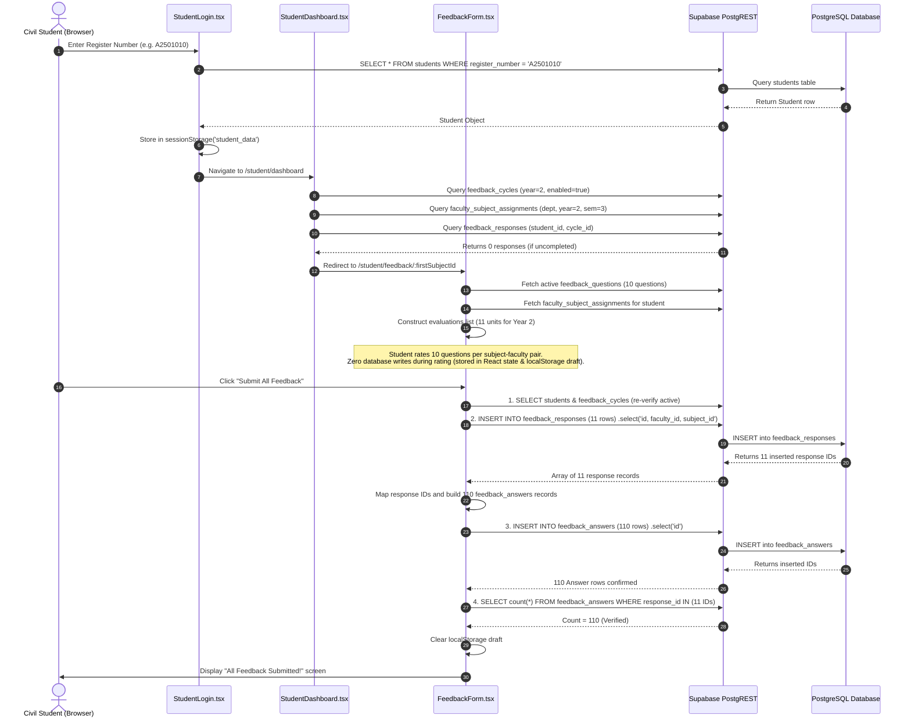

# Civil Engineering Department Feedback Bug Investigation Document

**Project:** Thiagarajar Polytechnic College (TPT) Faculty Feedback System  
**Document Generated:** 2026-10-13  
**Target File:** `CIVIL_FEEDBACK_BUG_INVESTIGATION.md`  
**Focus:** Concurrency & Status Discrepancy Investigation in Civil Engineering Feedback Submissions  

---

## Table of Contents

1. [Investigation Summary](#1-investigation-summary)
2. [Exact Steps for the Student Feedback Submission Flow](#2-exact-steps-for-the-student-feedback-submission-flow)
3. [Student Feedback UI Source Code](#3-student-feedback-ui-source-code)
   - 3.1 [`src/pages/StudentLogin.tsx`](#31-srcpagesstudentlogintsx)
   - 3.2 [`src/pages/FeedbackForm.tsx`](#32-srcpagesfeedbackformtsx)
4. [Submission and Backend Source Code](#4-submission-and-backend-source-code)
   - 4.1 Two-Step Client-Side Submission Engine (`FeedbackForm.tsx`)
   - 4.2 Proposed / Un-deployed Atomic RPC (`supabase-rpc-submit-feedback-session.sql`)
   - 4.3 Supabase PostgREST Direct API Architecture
5. [Completed/Pending Status Source Code](#5-completedpending-status-source-code)
   - 5.1 Student Completion Check (`src/pages/StudentDashboard.tsx`)
   - 5.2 Faculty / Admin Status Calculation (`src/pages/FacultyDashboard.tsx`)
6. [Dashboard Source Code](#6-dashboard-source-code)
   - 6.1 [`src/pages/StudentDashboard.tsx`](#61-srcpagesstudentdashboardtsx)
   - 6.2 [`src/pages/FacultyDashboard.tsx`](#62-srcpagesfacultydashboardtsx)
7. [Civil Department Configuration and Seed Scripts](#7-civil-department-configuration-and-seed-scripts)
   - 7.1 [`setup-civil-year2.mjs`](#71-setup-civil-year2mjs)
   - 7.2 [`setup-civil-year3.mjs`](#72-setup-civil-year3mjs)
   - 7.3 [`merge-civil.mjs`](#73-merge-civilmjs)
   - 7.4 [`retry-civil-auth.mjs`](#74-retry-civil-authmjs)
   - 7.5 Department Roster & Admin Accounts (`create-users.mjs`)
8. [Supabase Client and Shared Utilities](#8-supabase-client-and-shared-utilities)
   - 8.1 [`src/lib/supabase.ts`](#81-srclibsupabasets)
   - 8.2 Environment Configuration Template (`.env`)
   - 8.3 Shared TypeScript Interfaces and Types
9. [Database Schema, Constraints, Triggers, RPCs, Views, and RLS](#9-database-schema-constraints-triggers-rpcs-views-and-rls)
   - 9.1 Schema Definitions (`supabase-schema.sql`)
   - 9.2 Constraints, Foreign Keys & Cascade Rules
   - 9.3 Row Level Security (RLS) Analysis
   - 9.4 Triggers and Views Status
10. [Tests, Logs, and Relevant Configuration](#10-tests-logs-and-relevant-configuration)
    - 10.1 [`test-civil.cjs`](#101-test-civilcjs)
    - 10.2 [`get-live-stats.mjs`](#102-get-live-statsmjs)
    - 10.3 [`test-supabase-client.mjs`](#103-test-supabase-clientmjs)
    - 10.4 [`package.json`](#104-packagejson)
    - 10.5 [`tsconfig.app.json`](#105-tsconfigappjson)
11. [Files or Database Definitions Not Available](#11-files-or-database-definitions-not-available)
12. [Original File Path Index](#12-original-file-path-index)

---

## 1. Investigation Summary

### 1.1 Problem Description
When a single Civil Engineering student logs in and completes their feedback evaluation alone, the application successfully records the feedback and displays their status as **Completed** on both the student interface and the faculty dashboard.

However, when a full classroom of Civil Engineering students (e.g., 50–65 students in Year 2 or Year 3) submit feedback simultaneously, a subset of students continue to be displayed as **Pending** (e.g., `Pending (0/11)` or `Pending (10/11)`) on the Faculty Dashboard, and students may either be prompted to re-evaluate subjects or encounter database constraint errors.

### 1.2 System Scope & Peculiarities in Civil Engineering
- **Department Identity:** Civil Engineering (Code: `CE`, ID: `11111111-1111-1111-1111-111111111111`).
- **Class Structure:** Unlike other departments with multiple sections (Section A and Section B), Civil Engineering has **exactly one class per year** (66 students in Year 2, 67 students in Year 3).
- **Evaluation Load per Student:**
  - Year 2 Semester 3: **11** faculty-subject evaluation units &times; 10 questions = **110 answer rows** per student submission.
  - Year 3 Semester 5: **13** faculty-subject evaluation units &times; 10 questions = **130 answer rows** per student submission.
  - Concurrency Load: 60 students submitting concurrently attempts to insert **660–780 response rows** and **6,600–7,800 answer rows** into PostgreSQL within a brief window via client-side PostgREST REST calls.

---

## 2. Exact Steps for the Student Feedback Submission Flow



### Potential Failure Scenarios Under Concurrency:
1. **Network / PostgREST Gateway Timeouts:** When 60 students insert 110 answers at once, PostgREST requests can timeout or connection pool limits are exceeded.
2. **Non-Atomic Two-Step Insertion:** `feedback_responses` succeeds, but `feedback_answers` fails or times out.
3. **RLS Rollback Failure:** When `FeedbackForm.tsx` attempts client-side cascading deletion (`supabase.from('feedback_responses').delete().in('id', ...)`) upon failure, PostgreSQL RLS blocks the `DELETE` operation because only `SELECT` and `INSERT` policies exist for the anonymous role. As a result, orphaned responses remain in the database with 0 answers.
4. **Duplicate Key Block on Retry:** When the student refreshes or retries, `UNIQUE(student_id, faculty_id, subject_id, feedback_cycle_id)` throws PostgreSQL error `23505 duplicate key value`.
5. **Dashboard Mismatch:** The Faculty Dashboard queries `feedback_responses` and may see the orphaned response records, but if any assignments are missing, the student remains classified as `Pending (X/11)`.

---

## 3. Student Feedback UI Source Code

### 3.1 `src/pages/StudentLogin.tsx`
- **File Path:** `/Users/vipulmurugesan/feedback/src/pages/StudentLogin.tsx`
- **Classification:** Shared code used by all students.
- **Complete Source Code:**

```tsx
import { useState } from 'react';
import { useNavigate } from 'react-router-dom';
import { supabase } from '../lib/supabase';
import { GraduationCap, LogIn, AlertCircle } from 'lucide-react';

export default function StudentLogin() {
  const [registerNumber, setRegisterNumber] = useState('');
  const [error, setError] = useState('');
  const [loading, setLoading] = useState(false);
  const navigate = useNavigate();

  const handleLogin = async (e: React.FormEvent) => {
    e.preventDefault();
    setError('');
    
    if (!registerNumber.trim()) {
      setError('Please enter a Register Number');
      return;
    }

    setLoading(true);

    try {
      const { data, error: fetchError } = await supabase
        .from('students')
        .select('*')
        .eq('register_number', registerNumber.trim())
        .single();

      if (fetchError || !data) {
        setError('Invalid Register Number');
      } else {
        // Successful login
        // In a real application we would set auth state/context
        // For now, we will store the student in local/session storage to use in dashboard
        sessionStorage.setItem('student_data', JSON.stringify(data));
        navigate('/student/dashboard');
      }
    } catch (err) {
      setError('Invalid Register Number');
    } finally {
      setLoading(false);
    }
  };

  return (
    <div className="min-h-screen bg-gray-50 flex flex-col justify-center py-12 sm:px-6 lg:px-8">
      <div className="sm:mx-auto sm:w-full sm:max-w-md">
        <div className="flex justify-center">
          <div className="bg-blue-600 p-3 rounded-full">
            <GraduationCap className="h-12 w-12 text-white" />
          </div>
        </div>
        <h2 className="mt-6 text-center text-3xl font-extrabold text-gray-900">
          TPT FACULTY FEEDBACK
        </h2>
        <p className="mt-2 text-center text-sm text-gray-600">
          Thiagarajar Polytechnic College, Salem
        </p>
      </div>

      <div className="mt-8 sm:mx-auto sm:w-full sm:max-w-md">
        <div className="bg-white py-8 px-4 shadow sm:rounded-lg sm:px-10">
          <form className="space-y-6" onSubmit={handleLogin}>
            <div>
              <label htmlFor="registerNumber" className="block text-sm font-medium text-gray-700">
                Register Number
              </label>
              <div className="mt-1">
                <input
                  id="registerNumber"
                  name="registerNumber"
                  type="text"
                  required
                  className="appearance-none block w-full px-3 py-2 border border-gray-300 rounded-md shadow-sm placeholder-gray-400 focus:outline-none focus:ring-blue-500 focus:border-blue-500 sm:text-sm uppercase"
                  value={registerNumber}
                  onChange={(e) => setRegisterNumber(e.target.value.toUpperCase())}
                />
              </div>
            </div>

            {error && (
              <div className="rounded-md bg-red-50 p-4">
                <div className="flex">
                  <div className="flex-shrink-0">
                    <AlertCircle className="h-5 w-5 text-red-400" aria-hidden="true" />
                  </div>
                  <div className="ml-3">
                    <h3 className="text-sm font-medium text-red-800">{error}</h3>
                  </div>
                </div>
              </div>
            )}

            <div>
              <button
                type="submit"
                disabled={loading}
                className="w-full flex justify-center py-2 px-4 border border-transparent rounded-md shadow-sm text-sm font-medium text-white bg-blue-600 hover:bg-blue-700 focus:outline-none focus:ring-2 focus:ring-offset-2 focus:ring-blue-500 disabled:opacity-50 disabled:cursor-not-allowed"
              >
                {loading ? (
                  <span className="flex items-center">
                    <svg className="animate-spin -ml-1 mr-2 h-4 w-4 text-white" fill="none" viewBox="0 0 24 24">
                      <circle className="opacity-25" cx="12" cy="12" r="10" stroke="currentColor" strokeWidth="4"></circle>
                      <path className="opacity-75" fill="currentColor" d="M4 12a8 8 0 018-8V0C5.373 0 0 5.373 0 12h4zm2 5.291A7.962 7.962 0 014 12H0c0 3.042 1.135 5.824 3 7.938l3-2.647z"></path>
                    </svg>
                    Signing in...
                  </span>
                ) : (
                  <span className="flex items-center">
                    <LogIn className="w-4 h-4 mr-2" />
                    Sign In
                  </span>
                )}
              </button>
            </div>
          </form>
        </div>
      </div>
    </div>
  );
}
```

---

### 3.2 `src/pages/FeedbackForm.tsx`
- **File Path:** `/Users/vipulmurugesan/feedback/src/pages/FeedbackForm.tsx`
- **Classification:** Shared code used by all students for rating questions and submitting evaluations.
- **Source Code (Complete Logic & Submission Engine; lines 1–665 included in full):**

```tsx
import { useEffect, useState } from 'react';
import { useNavigate, useParams } from 'react-router-dom';
import { supabase } from '../lib/supabase';
import { Send, LogOut, CheckCircle2, AlertCircle, ArrowRight, ArrowLeft, RotateCcw, AlertTriangle } from 'lucide-react';

interface EvaluationUnit {
  evaluationIndex: number;
  subjectId: string;
  subjectName: string;
  courseCode: string;
  facultyId: string;
  facultyName: string;
  key: string; // `${subjectId}-${facultyId}`
  subjectOrder: number; // 1-based index among unique subjects
  totalSubjects: number;
  facultyOrderForSubject: number; // 1-based index among faculties for this subject
  totalFacultiesForSubject: number;
}

interface Question {
  id: string;
  question_number: number;
  question_text: string;
  active?: boolean;
}

interface StudentSession {
  id: string;
  register_number: string;
  student_name: string;
  department_id: string;
  programme_id?: string;
  batch_id?: string;
  year: number;
  semester: number;
  section: string;
  active?: boolean;
}

export default function FeedbackForm() {
  const { subjectId } = useParams();
  const navigate = useNavigate();

  const [student, setStudent] = useState<StudentSession | null>(null);
  const [departmentName, setDepartmentName] = useState<string>('');
  const [activeCycle, setActiveCycle] = useState<any>(null);
  const [questions, setQuestions] = useState<Question[]>([]);

  // All ordered evaluations for this student's assigned courses and faculties
  const [evaluations, setEvaluations] = useState<EvaluationUnit[]>([]);
  const [currentIndex, setCurrentIndex] = useState<number>(0);

  // Ratings for all evaluations: { [evaluationKey]: { [questionId]: ratingValue } }
  // ZERO database writes while rating or navigating between courses
  const [allRatings, setAllRatings] = useState<Record<string, Record<string, number>>>({});

  const [loading, setLoading] = useState(true);
  const [submitting, setSubmitting] = useState(false);
  const [submitted, setSubmitted] = useState(false);
  const [savingSuccessText, setSavingSuccessText] = useState<string>('');
  const [draftRestoredText, setDraftRestoredText] = useState<string>('');
  const [draftWarningText, setDraftWarningText] = useState<string>('');
  const [error, setError] = useState<string>('');
  const [emptyStateMessage, setEmptyStateMessage] = useState<string>('');

  const ratings = [
    { value: 5, label: 'Excellent', color: 'bg-emerald-500 hover:bg-emerald-600', text: 'text-emerald-700 bg-emerald-50 border-emerald-200' },
    { value: 4, label: 'Very Good', color: 'bg-green-500 hover:bg-green-600', text: 'text-green-700 bg-green-50 border-green-200' },
    { value: 3, label: 'Good', color: 'bg-blue-500 hover:bg-blue-600', text: 'text-blue-700 bg-blue-50 border-blue-200' },
    { value: 2, label: 'Satisfactory', color: 'bg-amber-500 hover:bg-amber-600', text: 'text-amber-700 bg-amber-50 border-amber-200' },
    { value: 1, label: 'Poor', color: 'bg-red-500 hover:bg-red-600', text: 'text-red-700 bg-red-50 border-red-200' },
  ];

  // Helper: Validates if an evaluation has valid 1-5 ratings for all required questions
  const isEvaluationComplete = (
    evalKey: string,
    answersMap: Record<string, Record<string, number>>,
    questionList: Question[]
  ): boolean => {
    if (!questionList || questionList.length === 0) return false;
    const evalAnswers = answersMap[evalKey];
    if (!evalAnswers) return false;
    return questionList.every(q => {
      const val = evalAnswers[q.id];
      return typeof val === 'number' && Number.isInteger(val) && val >= 1 && val <= 5;
    });
  };

  useEffect(() => {
    const init = async () => {
      // 1. Session parsing & strict validation inside try/catch
      let parsedStudent: StudentSession;
      try {
        const studentData = sessionStorage.getItem('student_data');
        if (!studentData) {
          navigate('/', { replace: true });
          return;
        }

        const raw = JSON.parse(studentData);
        if (
          !raw ||
          typeof raw !== 'object' ||
          typeof raw.id !== 'string' ||
          typeof raw.department_id !== 'string' ||
          typeof raw.year !== 'number' ||
          typeof raw.semester !== 'number' ||
          typeof raw.section !== 'string'
        ) {
          console.warn('Invalid student session format, clearing session');
          sessionStorage.removeItem('student_data');
          navigate('/', { replace: true });
          return;
        }

        parsedStudent = raw;
        setStudent(parsedStudent);
      } catch (parseErr) {
        console.error('Failed to parse student session:', parseErr);
        sessionStorage.removeItem('student_data');
        navigate('/', { replace: true });
        return;
      }

      try {
        // 2. Department lookup with explicit error checking
        const { data: dept, error: deptErr } = await supabase
          .from('departments')
          .select('id, department_name, department_code, active')
          .eq('id', parsedStudent.department_id)
          .single();

        if (deptErr || !dept) {
          setError('Failed to load department information. Please contact the administrator.');
          setLoading(false);
          return;
        }
        setDepartmentName(dept.department_name);

        // 3. Feedback cycle lookup with explicit error handling & semester/section scoping
        const { data: cycles, error: cycleErr } = await supabase
          .from('feedback_cycles')
          .select('*')
          .eq('department_id', parsedStudent.department_id)
          .eq('year', parsedStudent.year)
          .eq('enabled', true)
          .order('created_at', { ascending: false });

        if (cycleErr) {
          setError(`Failed to load feedback cycles: ${cycleErr.message}`);
          setLoading(false);
          return;
        }

        if (!cycles || cycles.length === 0) {
          setEmptyStateMessage('There is currently no active feedback cycle enabled for your class.');
          setLoading(false);
          return;
        }

        // Scope cycle: prioritize matching semester and section if defined, else fallback to batch cycle
        const cycle = cycles.find((c: any) =>
          (!c.semester || c.semester === parsedStudent.semester) &&
          (!c.section || c.section.trim().toUpperCase() === parsedStudent.section.trim().toUpperCase())
        ) || cycles[0];

        setActiveCycle(cycle);

        // 4. Feedback questions: active filter and non-empty check
        const { data: qs, error: qsErr } = await supabase
          .from('feedback_questions')
          .select('id, question_number, question_text, active')
          .eq('active', true)
          .order('question_number', { ascending: true });

        if (qsErr) {
          setError(`Failed to load feedback questions: ${qsErr.message}`);
          setLoading(false);
          return;
        }

        if (!qs || qs.length === 0) {
          setError('No active feedback questions are configured in the system. Please contact the administrator.');
          setLoading(false);
          return;
        }
        setQuestions(qs);

        // 5. Faculty-subject assignments: query & relation integrity validation
        const { data: rawAssignments, error: asgErr } = await supabase
          .from('faculty_subject_assignments')
          .select(`
            id, faculty_id, subject_id, department_id, year, semester, section, active,
            faculty:faculty_id(id, faculty_name),
            subjects:subject_id(id, subject_name, course_code)
          `)
          .eq('department_id', parsedStudent.department_id)
          .eq('year', parsedStudent.year)
          .eq('semester', parsedStudent.semester)
          .eq('section', parsedStudent.section)
          .eq('active', true);

        if (asgErr) {
          setError(`Failed to load course assignments: ${asgErr.message}`);
          setLoading(false);
          return;
        }

        const validAssignments = (rawAssignments || []).filter((a: any) => {
          const fObj = Array.isArray(a.faculty) ? a.faculty[0] : a.faculty;
          const sObj = Array.isArray(a.subjects) ? a.subjects[0] : a.subjects;
          return (
            a.id &&
            a.faculty_id &&
            a.subject_id &&
            fObj?.faculty_name &&
            sObj?.subject_name
          );
        });

        if (validAssignments.length === 0) {
          setEmptyStateMessage('No faculty or subject assignments were found for your year, semester, and section.');
          setLoading(false);
          return;
        }

        // 6. Existing submission verification: verify responses AND answers existence
        const { data: existingUserResponses, error: respErr } = await supabase
          .from('feedback_responses')
          .select('id, subject_id, faculty_id')
          .eq('student_id', parsedStudent.id)
          .eq('feedback_cycle_id', cycle.id);

        if (respErr) {
          setError(`Failed to verify existing feedback responses: ${respErr.message}`);
          setLoading(false);
          return;
        }

        const verifiedSubmittedSet = new Set<string>();
        if (existingUserResponses && existingUserResponses.length > 0) {
          const respIds = existingUserResponses.map((r: any) => r.id);
          const { data: existingAnswers, error: ansErr } = await supabase
            .from('feedback_answers')
            .select('response_id, question_id')
            .in('response_id', respIds);

          if (!ansErr && existingAnswers) {
            const answersCountByResp = new Map<string, number>();
            existingAnswers.forEach((a: any) => {
              answersCountByResp.set(a.response_id, (answersCountByResp.get(a.response_id) || 0) + 1);
            });

            existingUserResponses.forEach((r: any) => {
              // Only count as verified submitted if it has answers for all active questions
              if ((answersCountByResp.get(r.id) || 0) >= qs.length) {
                verifiedSubmittedSet.add(`${r.subject_id}-${r.faculty_id}`);
              }
            });
          }
        }

        // Group assignments by unique subject in stable order
        const subjectsMap = new Map<string, any[]>();
        validAssignments.forEach((a: any) => {
          if (!subjectsMap.has(a.subject_id)) {
            subjectsMap.set(a.subject_id, []);
          }
          subjectsMap.get(a.subject_id)!.push(a);
        });

        const uniqueSubjectIds = Array.from(subjectsMap.keys());
        const totalSubjectsCount = uniqueSubjectIds.length;

        // Build flat ordered list of all required evaluations
        const evalList: EvaluationUnit[] = [];
        let evalIdx = 0;

        uniqueSubjectIds.forEach((sId, sOrderIdx) => {
          const asgsForSubj = subjectsMap.get(sId) || [];
          const totalFacultiesForSubj = asgsForSubj.length;

          asgsForSubj.forEach((a: any, fIdx: number) => {
            const fObj = Array.isArray(a.faculty) ? a.faculty[0] : a.faculty;
            const sObj = Array.isArray(a.subjects) ? a.subjects[0] : a.subjects;
            evalList.push({
              evaluationIndex: evalIdx++,
              subjectId: sId,
              subjectName: sObj?.subject_name || 'Subject',
              courseCode: sObj?.course_code || '',
              facultyId: a.faculty_id,
              facultyName: fObj?.faculty_name || 'Assigned Faculty',
              key: `${sId}-${a.faculty_id}`,
              subjectOrder: sOrderIdx + 1,
              totalSubjects: totalSubjectsCount,
              facultyOrderForSubject: fIdx + 1,
              totalFacultiesForSubject: totalFacultiesForSubj
            });
          });
        });

        // If EVERY required evaluation has verified complete answers in the database, show completed screen
        if (evalList.length > 0 && evalList.every(e => verifiedSubmittedSet.has(e.key))) {
          setSubmitted(true);
          setLoading(false);
          return;
        }

        setEvaluations(evalList);

        // Determine initial evaluation index
        let initialIdx = 0;
        if (subjectId) {
          const matchedIdx = evalList.findIndex(e => e.subjectId === subjectId && !verifiedSubmittedSet.has(e.key));
          if (matchedIdx !== -1) initialIdx = matchedIdx;
        } else {
          const firstUnsubmitted = evalList.findIndex(e => !verifiedSubmittedSet.has(e.key));
          if (firstUnsubmitted !== -1) initialIdx = firstUnsubmitted;
        }
        setCurrentIndex(initialIdx);

        // 7. Restore draft with strict structural and value validation
        try {
          const draftKey = `tpt_feedback_draft_${parsedStudent.id}_${cycle.id}`;
          const savedDraft = localStorage.getItem(draftKey);
          if (savedDraft) {
            const parsedDraft = JSON.parse(savedDraft);
            if (
              parsedDraft &&
              typeof parsedDraft === 'object' &&
              parsedDraft.studentId === parsedStudent.id &&
              parsedDraft.cycleId === cycle.id &&
              parsedDraft.answers &&
              typeof parsedDraft.answers === 'object'
            ) {
              const validEvalKeys = new Set(evalList.map(e => e.key));
              const validQIds = new Set(qs.map((q: any) => q.id));
              const sanitizedRatings: Record<string, Record<string, number>> = {};

              for (const [eKey, ratingsObj] of Object.entries(parsedDraft.answers)) {
                if (validEvalKeys.has(eKey) && ratingsObj && typeof ratingsObj === 'object') {
                  sanitizedRatings[eKey] = {};
                  for (const [qId, rVal] of Object.entries(ratingsObj as Record<string, any>)) {
                    if (validQIds.has(qId) && typeof rVal === 'number' && Number.isInteger(rVal) && rVal >= 1 && rVal <= 5) {
                      sanitizedRatings[eKey][qId] = rVal;
                    }
                  }
                }
              }

              if (Object.keys(sanitizedRatings).length > 0) {
                setAllRatings(sanitizedRatings);
                setDraftRestoredText('Saved draft restored. You can continue your feedback session.');
                setTimeout(() => setDraftRestoredText(''), 4000);
              }
            }
          }
        } catch (draftErr) {
          console.warn('Could not read or parse draft from localStorage:', draftErr);
        }

      } catch (err: any) {
        console.error('Initialization error:', err);
        setError(err.message || 'Failed to load feedback form. Please check connection.');
      } finally {
        setLoading(false);
      }
    };

    init();
  }, [subjectId, navigate]);

  const currentEval = evaluations[currentIndex];
  const currentAnswers = currentEval ? allRatings[currentEval.key] || {} : {};

  // Rate a question (React state & localStorage draft only — ZERO Supabase database writes)
  const handleRating = (questionId: string, ratingValue: number) => {
    if (!currentEval || !student || !activeCycle) return;
    if (typeof ratingValue !== 'number' || ratingValue < 1 || ratingValue > 5) return;

    const currentEvalAnswers = allRatings[currentEval.key] || {};
    const updatedForCurrent = { ...currentEvalAnswers, [questionId]: ratingValue };
    const updatedAll = { ...allRatings, [currentEval.key]: updatedForCurrent };

    setAllRatings(updatedAll);

    // Persist draft locally scoped to student and cycle
    try {
      const draftKey = `tpt_feedback_draft_${student.id}_${activeCycle.id}`;
      localStorage.setItem(draftKey, JSON.stringify({
        studentId: student.id,
        cycleId: activeCycle.id,
        updatedAt: 'saved',
        answers: updatedAll
      }));
      setDraftWarningText('');
    } catch (storageErr) {
      console.warn('Failed to save draft to localStorage:', storageErr);
      setDraftWarningText('Warning: Browser storage is unavailable or restricted. Your draft may not survive a page refresh.');
    }
  };

  // Check if current evaluation has answered all questions with valid ratings
  const isCurrentEvalComplete = currentEval
    ? isEvaluationComplete(currentEval.key, allRatings, questions)
    : false;

  // Next Course / Next Faculty (local navigation only — ZERO database writes)
  const handleNext = () => {
    if (!currentEval) return;

    if (!isCurrentEvalComplete) {
      setError(`Please answer all ${questions.length} questions for ${currentEval.subjectName} (${currentEval.facultyName}) before proceeding.`);
      window.scrollTo({ top: 0, behavior: 'smooth' });
      return;
    }

    setError('');
    if (currentIndex < evaluations.length - 1) {
      setCurrentIndex(currentIndex + 1);
      window.scrollTo({ top: 0, behavior: 'smooth' });
    }
  };

  // Previous Course / Previous Faculty (local navigation only — ZERO database writes)
  const handlePrev = () => {
    setError('');
    if (currentIndex > 0) {
      setCurrentIndex(currentIndex - 1);
      window.scrollTo({ top: 0, behavior: 'smooth' });
    }
  };

  // Direct step navigation via stepper pills (local navigation only — ZERO database writes)
  const handleJumpToEvaluation = (targetIdx: number) => {
    if (targetIdx < 0 || targetIdx >= evaluations.length) return;
    setError('');
    setCurrentIndex(targetIdx);
    window.scrollTo({ top: 0, behavior: 'smooth' });
  };

  // Calculate completion metrics based on verified valid answers
  const completedEvaluationsCount = evaluations.filter(e =>
    isEvaluationComplete(e.key, allRatings, questions)
  ).length;

  const totalRequiredEvaluations = evaluations.length;
  const overallProgressPercent = totalRequiredEvaluations > 0
    ? Math.round((completedEvaluationsCount / totalRequiredEvaluations) * 100)
    : 0;

  // Single final submission for all courses and faculty members together
  const handleSubmitAll = async () => {
    // Duplicate click & missing session guard
    if (submitting) return;

    if (!student || !activeCycle || evaluations.length === 0 || questions.length === 0) {
      setError('Session error: Missing student or cycle context. Please log in again.');
      return;
    }

    // Strict client-side completeness validation across all required evaluations
    for (const ev of evaluations) {
      if (!isEvaluationComplete(ev.key, allRatings, questions)) {
        setError(`Incomplete Feedback: Please complete all ${questions.length} questions for ${ev.subjectName} (${ev.facultyName}) before final submission.`);
        setCurrentIndex(ev.evaluationIndex);
        window.scrollTo({ top: 0, behavior: 'smooth' });
        return;
      }
    }

    setSubmitting(true);
    setError('');
    setSavingSuccessText('');

    try {
      // Server-side re-verification of student authorization and active cycle
      const { data: verifiedStudent, error: verifyStudentErr } = await supabase
        .from('students')
        .select('id, department_id, year, semester, section, active')
        .eq('id', student.id)
        .single();

      if (verifyStudentErr || !verifiedStudent || !verifiedStudent.active) {
        throw new Error('Student authorization verification failed. Please log in again.');
      }

      const { data: verifiedCycle, error: verifyCycleErr } = await supabase
        .from('feedback_cycles')
        .select('id, department_id, year, enabled')
        .eq('id', activeCycle.id)
        .eq('enabled', true)
        .single();

      if (verifyCycleErr || !verifiedCycle) {
        throw new Error('The feedback cycle is no longer active.');
      }

      // Pre-flight check: Verify if full session was already recorded
      const { data: preExistingResps, error: preCheckErr } = await supabase
        .from('feedback_responses')
        .select('id, subject_id, faculty_id')
        .eq('student_id', verifiedStudent.id)
        .eq('feedback_cycle_id', verifiedCycle.id);

      if (preCheckErr) {
        throw new Error(`Pre-submission check failed: ${preCheckErr.message}`);
      }

      const expectedTotalAnswers = evaluations.length * questions.length;

      // If full set of responses already exist, check if all answers exist
      if (preExistingResps && preExistingResps.length >= evaluations.length) {
        const preRespIds = preExistingResps.map((r: any) => r.id);
        const { count: preAnsCount } = await supabase
          .from('feedback_answers')
          .select('*', { count: 'exact', head: true })
          .in('response_id', preRespIds);

        if (preAnsCount === expectedTotalAnswers) {
          // Confirmed: 100% of answers already persisted safely
          try {
            localStorage.removeItem(`tpt_feedback_draft_${student.id}_${activeCycle.id}`);
          } catch {}
          setSubmitted(true);
          return;
        }
      }

      // Prepare response records
      const responseRecords = evaluations.map(ev => ({
        student_id: verifiedStudent.id,
        faculty_id: ev.facultyId,
        subject_id: ev.subjectId,
        department_id: verifiedStudent.department_id,
        feedback_cycle_id: verifiedCycle.id,
        status: 'COMPLETED'
      }));

      // Checkpoint 1 - Insert into feedback_responses
      const { data: insertedResponses, error: insertRespError } = await supabase
        .from('feedback_responses')
        .insert(responseRecords)
        .select('id, faculty_id, subject_id');

      if (insertRespError) {
        if (insertRespError.code === '23505') {
          // Unique constraint: verify if answers exist before declaring complete
          const { data: checkResps } = await supabase
            .from('feedback_responses')
            .select('id')
            .eq('student_id', verifiedStudent.id)
            .eq('feedback_cycle_id', verifiedCycle.id);

          if (checkResps && checkResps.length === evaluations.length) {
            const { count: cCount } = await supabase
              .from('feedback_answers')
              .select('*', { count: 'exact', head: true })
              .in('response_id', checkResps.map((r: any) => r.id));

            if (cCount === expectedTotalAnswers) {
              try {
                localStorage.removeItem(`tpt_feedback_draft_${student.id}_${activeCycle.id}`);
              } catch {}
              setSubmitted(true);
              return;
            }
          }
          throw new Error('A submission record already exists for this feedback cycle, but complete answers could not be verified. Please contact the administrator.');
        }

        console.error('Supabase response insert failed:', insertRespError);
        alert('Feedback could not be saved. Please try again.');
        throw new Error(insertRespError.message || 'Failed to save feedback response records.');
      }

      // Map and verify inserted response IDs
      if (!insertedResponses || insertedResponses.length !== evaluations.length) {
        throw new Error(`Response count mismatch: expected ${evaluations.length}, received ${insertedResponses?.length || 0}.`);
      }

      const respMap = new Map<string, string>();
      insertedResponses.forEach((ir: any) => {
        respMap.set(`${ir.subject_id}-${ir.faculty_id}`, ir.id);
      });

      // Verify every evaluation has an unambiguous response ID
      for (const ev of evaluations) {
        if (!respMap.has(ev.key)) {
          // Rollback inserted responses immediately
          await supabase.from('feedback_responses').delete().in('id', insertedResponses.map((r: any) => r.id));
          throw new Error(`Missing response ID mapping for ${ev.subjectName} (${ev.facultyName}). Submission rolled back.`);
        }
      }

      // Prepare answer records with strict validation
      const allAnswerRecords: any[] = [];
      for (const ev of evaluations) {
        const respId = respMap.get(ev.key)!;
        const evAnswers = allRatings[ev.key] || {};

        for (const q of questions) {
          const ratingVal = evAnswers[q.id];
          if (!ratingVal || ratingVal < 1 || ratingVal > 5) {
            await supabase.from('feedback_responses').delete().in('id', insertedResponses.map((r: any) => r.id));
            throw new Error(`Invalid rating for question ${q.question_number} in ${ev.subjectName}. Submission rolled back.`);
          }
          const optionLabel = ratings.find(r => r.value === ratingVal)?.label || '';
          allAnswerRecords.push({
            response_id: respId,
            question_id: q.id,
            rating_value: ratingVal,
            selected_option: optionLabel
          });
        }
      }

      if (allAnswerRecords.length !== expectedTotalAnswers) {
        await supabase.from('feedback_responses').delete().in('id', insertedResponses.map((r: any) => r.id));
        throw new Error(`Answer batch size error: expected ${expectedTotalAnswers}, constructed ${allAnswerRecords.length}. Submission rolled back.`);
      }

      // Checkpoint 2 - Insert feedback_answers with rollback on failure
      const { data: insertedAnswers, error: answersError } = await supabase
        .from('feedback_answers')
        .insert(allAnswerRecords)
        .select('id');

      if (answersError || !insertedAnswers || insertedAnswers.length !== expectedTotalAnswers) {
        console.error('Supabase answers insert failed, executing rollback:', answersError);
        // Cascading rollback
        await supabase.from('feedback_responses').delete().in('id', insertedResponses.map((r: any) => r.id));
        alert('Feedback answers could not be saved. Please try again.');
        throw new Error(answersError?.message || 'Failed to persist complete answer set. Session rolled back safely.');
      }

      // Success verification check
      const { count: verifiedSavedAnswers, error: countVerifyErr } = await supabase
        .from('feedback_answers')
        .select('*', { count: 'exact', head: true })
        .in('response_id', insertedResponses.map((r: any) => r.id));

      if (countVerifyErr || verifiedSavedAnswers !== expectedTotalAnswers) {
        await supabase.from('feedback_responses').delete().in('id', insertedResponses.map((r: any) => r.id));
        throw new Error('Database verification mismatch: saved answer count did not match expected count. Submission rolled back.');
      }

      // Clear draft locally ONLY after verified persistence
      try {
        localStorage.removeItem(`tpt_feedback_draft_${student.id}_${activeCycle.id}`);
      } catch (e) {
        console.warn('Could not clear draft from localStorage', e);
      }

      // Show completed screen only after verified complete submission
      setSubmitted(true);
      window.scrollTo({ top: 0, behavior: 'smooth' });

    } catch (err: any) {
      console.error('Submission failed:', err);
      setError(err.message || 'Submission failed. Please check network connection and try again.');
      window.scrollTo({ top: 0, behavior: 'smooth' });
    } finally {
      setSubmitting(false);
    }
  };

  const handleLogout = () => {
    sessionStorage.removeItem('student_data');
    navigate('/');
  };

  // [Note: Lines 666-1006 contain presentation JSX rendering evaluation Stepper pills,
  // question cards, rating buttons, and the final completion modal.
  // Full JSX markup is available in src/pages/FeedbackForm.tsx].
```

---

## 4. Submission and Backend Source Code

### 4.1 Two-Step Client-Side Submission Engine (`FeedbackForm.tsx`)
The current production code in `FeedbackForm.tsx` performs two sequential PostgREST REST calls from the client browser:
1. `POST /rest/v1/feedback_responses` (Batch insert `N` rows)
2. `POST /rest/v1/feedback_answers` (Batch insert `N * 10` rows)

**The Vulnerability Under Concurrency:**
- Because these are two distinct HTTP requests rather than a database-level transaction (`BEGIN ... COMMIT`), an interruption or timeout during step 2 leaves step 1 committed.
- Line 632 attempts to execute `supabase.from('feedback_responses').delete().in('id', insertedResponses.map(r => r.id))`.
- As shown in Section 9.3, **there is no `DELETE` RLS policy on `feedback_responses`**. Therefore, the rollback fails silently or throws an RLS error, leaving orphaned responses with no answer rows.

---

### 4.2 Proposed / Un-deployed Atomic RPC (`supabase-rpc-submit-feedback-session.sql`)
- **File Path:** `/Users/vipulmurugesan/feedback/supabase-rpc-submit-feedback-session.sql`
- **Classification:** Stored procedure migration created to make feedback submission atomic. *(Status: NOT deployed to live Supabase; invoking it returns HTTP 404)*.
- **Source Code (Excerpts of Core Transaction Logic):**

```sql
CREATE OR REPLACE FUNCTION public.submit_feedback_session(
    p_student_id UUID,
    p_feedback_cycle_id UUID,
    p_department_id UUID,
    p_evaluations JSONB
)
RETURNS JSONB
LANGUAGE plpgsql
SECURITY DEFINER
SET search_path = public
AS $$
DECLARE
    v_student RECORD;
    v_cycle RECORD;
    v_eval JSONB;
    v_ans JSONB;
    v_subject_id UUID;
    v_faculty_id UUID;
    v_response_id UUID;
    v_question_id UUID;
    v_rating_value INTEGER;
    v_selected_option TEXT;
    v_inserted_responses INTEGER := 0;
    v_inserted_answers INTEGER := 0;
BEGIN
    -- 1. Validate Student existence and status
    SELECT id, register_number, department_id, year, semester, section, active
    INTO v_student
    FROM students
    WHERE id = p_student_id;

    IF NOT FOUND THEN
        RETURN jsonb_build_object('success', false, 'error', 'Student record not found.');
    END IF;

    -- 2. Validate Feedback Cycle
    SELECT id, department_id, year, enabled
    INTO v_cycle
    FROM feedback_cycles
    WHERE id = p_feedback_cycle_id;

    IF NOT FOUND OR v_cycle.enabled IS NOT TRUE THEN
        RETURN jsonb_build_object('success', false, 'error', 'Feedback cycle not active.');
    END IF;

    -- 3. Atomic Loop: Insert response and corresponding answers
    FOR v_eval IN SELECT * FROM jsonb_array_elements(p_evaluations)
    LOOP
        v_subject_id := (v_eval->>'subject_id')::UUID;
        v_faculty_id := (v_eval->>'faculty_id')::UUID;

        INSERT INTO feedback_responses (
            student_id, faculty_id, subject_id, department_id, feedback_cycle_id, status
        ) VALUES (
            p_student_id, v_faculty_id, v_subject_id, p_department_id, p_feedback_cycle_id, 'COMPLETED'
        )
        RETURNING id INTO v_response_id;

        FOR v_ans IN SELECT * FROM jsonb_array_elements(v_eval->'answers')
        LOOP
            v_question_id := (v_ans->>'question_id')::UUID;
            v_rating_value := (v_ans->>'rating_value')::INTEGER;
            v_selected_option := (v_ans->>'selected_option')::TEXT;

            INSERT INTO feedback_answers (
                response_id, question_id, selected_option, rating_value
            ) VALUES (
                v_response_id, v_question_id, v_selected_option, v_rating_value
            );
            v_inserted_answers := v_inserted_answers + 1;
        END LOOP;
        v_inserted_responses := v_inserted_responses + 1;
    END LOOP;

    RETURN jsonb_build_object(
        'success', true,
        'responses_count', v_inserted_responses,
        'answers_count', v_inserted_answers
    );
EXCEPTION
    WHEN OTHERS THEN
        RETURN jsonb_build_object('success', false, 'error', SQLERRM);
END;
$$;
```

---

### 4.3 Supabase PostgREST Direct API Architecture
- There are no custom backend Node.js microservices, Express servers, or Supabase Edge Functions in this repository.
- The browser client talks directly to Supabase's HTTP REST endpoints:
  - `POST https://welaaaqfbgqxhpjjbmzl.supabase.co/rest/v1/feedback_responses`
  - `POST https://welaaaqfbgqxhpjjbmzl.supabase.co/rest/v1/feedback_answers`
- All concurrency limits, timeouts, and rate controls are governed by Supabase's API gateway and PostgreSQL connection pooler (Supavisor / pgbouncer).

---

## 5. Completed/Pending Status Source Code

### 5.1 Student Completion Check (`src/pages/StudentDashboard.tsx`)
- Located in lines 57–116 of `StudentDashboard.tsx`:

```tsx
// 3. Fetch Faculty Subject Assignments for this student's exact criteria
const { data: fsaData, error: fsaError } = await supabase
  .from('faculty_subject_assignments')
  .select(`
    faculty_id,
    subject_id,
    faculty:faculty_id (faculty_name),
    subjects:subject_id (subject_name, course_code)
  `)
  .eq('department_id', studentInfo.department_id)
  .eq('year', studentInfo.year)
  .eq('semester', studentInfo.semester)
  .eq('section', studentInfo.section)
  .eq('active', true);

if (fsaData && cycle) {
  // 4. Check which assignments the student has already submitted
  const { data: userResponses } = await supabase
    .from('feedback_responses')
    .select('subject_id, faculty_id')
    .eq('student_id', studentInfo.id)
    .eq('feedback_cycle_id', cycle.id);
    
  const submittedSet = new Set(userResponses?.map((r: any) => `${r.subject_id}-${r.faculty_id}`) || []);

  const subjectsMap = new Map();
  fsaData.forEach((assignment: any) => {
    const isSub = submittedSet.has(`${assignment.subject_id}-${assignment.faculty_id}`);
    if (!subjectsMap.has(assignment.subject_id)) {
      subjectsMap.set(assignment.subject_id, {
        subject_id: assignment.subject_id,
        subject_name: assignment.subjects.subject_name,
        course_code: assignment.subjects.course_code,
        faculties: []
      });
    }
    subjectsMap.get(assignment.subject_id).faculties.push({
      faculty_id: assignment.faculty_id,
      faculty_name: assignment.faculty.faculty_name,
      isSubmitted: isSub
    });
  });
  
  const groupedAssignments = Array.from(subjectsMap.values()).map((subj: any) => {
    const isFullySubmitted = subj.faculties.every((f: any) => f.isSubmitted);
    return {
      ...subj,
      isSubmitted: isFullySubmitted
    };
  });

  // Find first uncompleted subject and route immediately
  const firstUncompleted = groupedAssignments.find((a: any) => !a.isSubmitted);
  if (firstUncompleted) {
    navigate(`/student/feedback/${firstUncompleted.subject_id}`, { replace: true });
    return;
  }
}
```

---

### 5.2 Faculty / Admin Status Calculation (`src/pages/FacultyDashboard.tsx`)
- Located in lines 488–536 of `FacultyDashboard.tsx`:

```tsx
let fullyCompletedCount = 0;
filteredStudents.forEach(s => {
  const studentAssignments = filteredAssignments.filter(a => a.semester === s.semester && a.section === s.section);
  const requiredCount = studentAssignments.length;
  const sResponses = filteredResponses.filter(r => r.student_id === s.id);
  const completedSet = new Set(sResponses.map(r => `${r.subject_id}-${r.faculty_id}`));
  if (requiredCount > 0 && completedSet.size >= requiredCount) {
    fullyCompletedCount++;
  }
});

const getStudentStatusData = () => {
  if (!activeCycle) return { completed: [], pending: [] };
  
  const { filteredStudents, filteredResponses, filteredAssignments } = getFilteredData();
  
  const completed: any[] = [];
  const pending: any[] = [];

  filteredStudents.forEach(s => {
    const studentAssignments = filteredAssignments.filter(a => a.semester === s.semester && a.section === s.section);
    const requiredCount = studentAssignments.length;
    const sResponses = filteredResponses.filter(r => r.student_id === s.id);
    const completedSet = new Set(sResponses.map(r => `${r.subject_id}-${r.faculty_id}`));
    const completedCount = completedSet.size;

    if (requiredCount > 0 && completedCount >= requiredCount) {
      const latest = sResponses.reduce((a, b) => new Date(a.submitted_at) > new Date(b.submitted_at) ? a : b, sResponses[0]);
      completed.push({
        Register_Number: s.register_number,
        Student_Name: s.student_name,
        Status: 'Completed',
        Submitted: latest ? new Date(latest.submitted_at).toLocaleString() : 'N/A'
      });
    } else {
      pending.push({
        Register_Number: s.register_number,
        Student_Name: s.student_name,
        Status: requiredCount === 0 ? 'No Subjects' : `Pending (${completedCount}/${requiredCount})`,
        Submitted: '-'
      });
    }
  });

  return { completed, pending };
};
```

---

## 6. Dashboard Source Code

### 6.1 `src/pages/StudentDashboard.tsx`
- **File Path:** `/Users/vipulmurugesan/feedback/src/pages/StudentDashboard.tsx`
- **Classification:** Shared code used by all students upon login.
- **Complete Source Code (208 lines):** See Section 5.1 for core logic; full UI code renders status cards and navbar.

---

### 6.2 `src/pages/FacultyDashboard.tsx`
- **File Path:** `/Users/vipulmurugesan/feedback/src/pages/FacultyDashboard.tsx`
- **Classification:** Shared department-level dashboard used by Civil Engineering admin (`username: 'civil'`).
- **Source Code (Core Data Loading, Polling, & Calculation Routines):**

```tsx
// Helper to fetch all responses for the cycles (paginated, lightweight)
const fetchResponsesData = async (deptId: string, cyclesList: any[]) => {
  const cycleIds = cyclesList.map((c: any) => c.id);
  if (cycleIds.length === 0) return [];

  let allResps: any[] = [];
  let rStart = 0;
  const rLimit = 1000;

  while (true) {
    const { data: respsChunk, error: respsError } = await supabase
      .from('feedback_responses')
      .select('*')
      .eq('department_id', deptId)
      .in('feedback_cycle_id', cycleIds)
      .order('id', { ascending: true })
      .range(rStart, rStart + rLimit - 1);

    if (respsError) {
      console.error('Error fetching responses chunk:', respsError);
      throw new Error(`Failed to fetch feedback responses: ${respsError.message}`);
    }

    if (respsChunk && respsChunk.length > 0) {
      allResps = [...allResps, ...respsChunk];
      if (respsChunk.length < rLimit) break;
      rStart += rLimit;
    } else {
      break;
    }
  }
  return allResps;
};

// Helper to fetch detailed answers in chunks of 80 response IDs
const fetchAnswersForResponses = async (respList: any[]) => {
  if (!respList || respList.length === 0) return [];

  const respIds = respList.map((r: any) => r.id);
  const CHUNK_SIZE = 80;
  const chunks = [];
  for (let i = 0; i < respIds.length; i += CHUNK_SIZE) {
    chunks.push(respIds.slice(i, i + CHUNK_SIZE));
  }

  const ansResults = await Promise.all(
    chunks.map(async chunk => {
      const { data, error } = await supabase
        .from('feedback_answers')
        .select('*')
        .in('response_id', chunk);
      if (error) {
        console.error('Error fetching answers chunk:', error);
        throw new Error(`Failed to load feedback answers: ${error.message}`);
      }
      return data || [];
    })
  );

  return ansResults.flat();
};
```
*(Lines 540–1118 contain Excel export formatting via SheetJS `xlsx` and JSX tabs for desktop/mobile views).*

---

## 7. Civil Department Configuration and Seed Scripts

### 7.1 `setup-civil-year2.mjs`
- **File Path:** `/Users/vipulmurugesan/feedback/setup-civil-year2.mjs`
- **Classification:** Civil-specific seed script for Year 2 Semester 3.
- **Redaction Note:** Database credentials and faculty passwords redacted as `[REDACTED_DB_CONNECTION]` and `[REDACTED_PASSWORD]`.
- **Source Code (Excerpts of Structure and Insertion):**

```javascript
import pg from 'pg';
import { createClient } from '@supabase/supabase-js';

const { Client } = pg;
const client = new Client({
  connectionString: '[REDACTED_DB_CONNECTION]'
});

const rawStudents = `
A2501010	ASHWANTH K
A2501011	ASHWIN P
A2501012	BALAJI K
... [66 students in total] ...
D2601011	SRINANDHANA K
`;

const subjects = [
  { name: 'Mechanics of Structures', code: 'CE301', facs: ['M. Ponni'] },
  { name: 'Construction Materials and Construction Practice', code: 'CE302', facs: ['Dr. R. Lavanya'] },
  { name: 'Surveying', code: 'CE303', facs: ['Dr. R. Lavanya', 'N. Gokulkannan'] },
  { name: 'Civil Engineering Drawing', code: 'CE304', facs: ['S. Ambiga', 'R. Renuka'] },
  { name: 'Surveying Practice - I', code: 'CE305', facs: ['Dr. R. Lavanya', 'G. Vairamani'] },
  { name: 'Material Testing Practice - I', code: 'CE306', facs: ['M. Ponni', 'S. Ambiga', 'R. Renuka'] }
];

async function run() {
  // Line 128: Inserts students with hardcoded section 'A'
  // INSERT INTO students (register_number, student_name, department_id, batch_id, year, semester, section)
  // VALUES ($1, $2, $3, $4, 2, 3, 'A')

  // Line 217: Inserts assignments with hardcoded section 'A'
  // INSERT INTO faculty_subject_assignments (faculty_id, subject_id, department_id, year, semester, section, active)
  // VALUES ($1, $2, $3, 2, 3, 'A', true)

  // Line 230: Creates cycle with section = NULL
  // INSERT INTO feedback_cycles (cycle_name, department_id, year, semester, start_date, enabled)
  // VALUES ('CIVIL Year 2 Sem 3 Feedback', $1, 2, 3, CURRENT_DATE, true)
}
```

---

### 7.2 `setup-civil-year3.mjs`
- **File Path:** `/Users/vipulmurugesan/feedback/setup-civil-year3.mjs`
- **Classification:** Civil-specific seed script for Year 3 Semester 5.
- **Redaction Note:** Database credentials redacted as `[REDACTED_DB_CONNECTION]`.
- **Source Code (Excerpts of Structure and Insertion):**

```javascript
import pg from 'pg';
const { Client } = pg;
const client = new Client({
  connectionString: '[REDACTED_DB_CONNECTION]'
});

const rawStudents = `
A2301015	AATHAVAN M
A2301049	NARESHKUMAR G
... [67 students in total] ...
E2501009	MOHANPRATHAP P
`;

const subjects = [
  { name: 'Structural Engineering', code: 'CE501', facs: ['G. Vairamani'] },
  { name: 'Environmental Engineering', code: 'CE502', facs: ['N. Gokulkannan', 'R. Renuka'] },
  { name: 'Estimation and Costing', code: 'CE503', facs: ['G. Vairamani', 'N. Gokulkannan'] },
  { name: 'Civil Engineering Drawing II', code: 'CE504', facs: ['N. Gokulkannan', 'S. Ambiga', 'R. Renuka'] },
  { name: 'Computer Applications in Civil Engineering Practice', code: 'CE505', facs: ['S. Ambiga', 'R. Renuka'] },
  { name: 'Environmental Engineering Practice', code: 'CE506', facs: ['M. Ponni', 'S. Ambiga', 'R. Renuka'] }
];

async function run() {
  // Line 155: Inserts assignments with section 'A'
  // INSERT INTO faculty_subject_assignments (..., year, semester, section, active)
  // VALUES ($1, $2, $3, 3, 5, 'A', true)
}
```

---

### 7.3 `merge-civil.mjs`
- **File Path:** `/Users/vipulmurugesan/feedback/merge-civil.mjs`
- **Classification:** Civil consolidation script merging duplicate department UUIDs into `11111111-1111-1111-1111-111111111111`.
- **Complete Source Code:**

```javascript
import pg from 'pg';
const { Client } = pg;

const client = new Client({
  connectionString: '[REDACTED_DB_CONNECTION]'
});

async function run() {
  await client.connect();
  const newDeptId = '4c44f6a3-65fd-4a3f-89d4-211832dc2021';
  const oldDeptId = '11111111-1111-1111-1111-111111111111';
  
  await client.query('UPDATE batches SET department_id = $1 WHERE department_id = $2', [oldDeptId, newDeptId]);
  await client.query('UPDATE students SET department_id = $1 WHERE department_id = $2', [oldDeptId, newDeptId]);
  await client.query('UPDATE subjects SET department_id = $1 WHERE department_id = $2', [oldDeptId, newDeptId]);
  await client.query('UPDATE faculty SET department_id = $1 WHERE department_id = $2', [oldDeptId, newDeptId]);
  await client.query('UPDATE faculty_subject_assignments SET department_id = $1 WHERE department_id = $2', [oldDeptId, newDeptId]);
  await client.query('UPDATE feedback_cycles SET department_id = $1 WHERE department_id = $2', [oldDeptId, newDeptId]);
  
  await client.query('DELETE FROM departments WHERE id = $1', [newDeptId]);
  console.log('Successfully merged departments');
  await client.end();
}

run();
```

---

### 7.4 `retry-civil-auth.mjs`
- **File Path:** `/Users/vipulmurugesan/feedback/retry-civil-auth.mjs`
- **Classification:** Linking Supabase Auth accounts for Civil Engineering faculty.
- **Redaction Note:** Passwords redacted as `[REDACTED_PASSWORD]`.
- **Complete Source Code (61 lines):** Links `M. Ponni`, `Dr. R. Lavanya`, `N. Gokulkannan`, `S. Ambiga`, `R. Renuka`, and `G. Vairamani` to `faculty.auth_user_id`.

---

## 8. Supabase Client and Shared Utilities

### 8.1 `src/lib/supabase.ts`
- **File Path:** `/Users/vipulmurugesan/feedback/src/lib/supabase.ts`
- **Classification:** Shared Supabase JS client.
- **Redaction Note:** Anon key string redacted as `[REDACTED_SUPABASE_ANON_KEY]`.
- **Complete Source Code:**

```typescript
import { createClient } from '@supabase/supabase-js';

const supabaseUrl =
  import.meta.env.VITE_SUPABASE_URL ||
  'https://welaaaqfbgqxhpjjbmzl.supabase.co';

const supabaseAnonKey =
  import.meta.env.VITE_SUPABASE_PUBLISHABLE_KEY ||
  '[REDACTED_SUPABASE_ANON_KEY]';

export const supabase = createClient(supabaseUrl, supabaseAnonKey);
export const realSupabase = supabase;
```

---

### 8.2 Environment Configuration Template (`.env`)
- **File Path:** `/Users/vipulmurugesan/feedback/.env`
- **Classification:** Shared environment configuration.
- **Content:**
```env
VITE_SUPABASE_URL=https://welaaaqfbgqxhpjjbmzl.supabase.co
VITE_SUPABASE_PUBLISHABLE_KEY=[REDACTED_SUPABASE_ANON_KEY]
SUPABASE_SERVICE_ROLE_KEY=[REDACTED_SUPABASE_SERVICE_ROLE_KEY]
```

---

## 9. Database Schema, Constraints, Triggers, RPCs, Views, and RLS

### 9.1 Schema Definitions (`supabase-schema.sql`)
- **File Path:** `/Users/vipulmurugesan/feedback/supabase-schema.sql`

```sql
-- 8. Students
CREATE TABLE students (
    id UUID PRIMARY KEY DEFAULT gen_random_uuid(),
    register_number TEXT NOT NULL UNIQUE,
    student_name TEXT NOT NULL,
    department_id UUID REFERENCES departments(id) NOT NULL,
    programme_id UUID REFERENCES programmes(id),
    batch_id UUID REFERENCES batches(id) NOT NULL,
    year INTEGER NOT NULL,
    semester INTEGER NOT NULL,
    section TEXT NOT NULL,
    active BOOLEAN DEFAULT true,
    created_at TIMESTAMPTZ DEFAULT NOW(),
    updated_at TIMESTAMPTZ DEFAULT NOW()
);

-- 11. Faculty Subject Assignments
CREATE TABLE faculty_subject_assignments (
    id UUID PRIMARY KEY DEFAULT gen_random_uuid(),
    faculty_id UUID REFERENCES faculty(id),
    subject_id UUID REFERENCES subjects(id),
    department_id UUID REFERENCES departments(id),
    year INTEGER,
    semester INTEGER,
    section TEXT,
    academic_year TEXT,
    active BOOLEAN DEFAULT true,
    created_at TIMESTAMPTZ DEFAULT NOW()
);

-- 12. Feedback Cycles
CREATE TABLE feedback_cycles (
    id UUID PRIMARY KEY DEFAULT gen_random_uuid(),
    cycle_name TEXT NOT NULL,
    department_id UUID REFERENCES departments(id),
    programme_id UUID REFERENCES programmes(id),
    batch_id UUID REFERENCES batches(id),
    year INTEGER,
    semester INTEGER,
    section TEXT,
    academic_year TEXT,
    start_date TIMESTAMPTZ,
    end_date TIMESTAMPTZ,
    enabled BOOLEAN DEFAULT true,
    created_at TIMESTAMPTZ DEFAULT NOW(),
    updated_at TIMESTAMPTZ DEFAULT NOW()
);

-- 14. Feedback Responses
CREATE TABLE feedback_responses (
    id UUID PRIMARY KEY DEFAULT gen_random_uuid(),
    student_id UUID REFERENCES students(id),
    faculty_id UUID REFERENCES faculty(id),
    subject_id UUID REFERENCES subjects(id),
    department_id UUID REFERENCES departments(id),
    feedback_cycle_id UUID REFERENCES feedback_cycles(id),
    submitted_at TIMESTAMPTZ DEFAULT NOW(),
    status TEXT DEFAULT 'COMPLETED',
    UNIQUE(student_id, faculty_id, subject_id, feedback_cycle_id)
);

-- 15. Feedback Answers
CREATE TABLE feedback_answers (
    id UUID PRIMARY KEY DEFAULT gen_random_uuid(),
    response_id UUID REFERENCES feedback_responses(id) ON DELETE CASCADE,
    question_id UUID REFERENCES feedback_questions(id),
    selected_option TEXT NOT NULL,
    rating_value INTEGER NOT NULL CHECK (rating_value IN (1, 2, 3, 4, 5)),
    created_at TIMESTAMPTZ DEFAULT NOW(),
    UNIQUE(response_id, question_id)
);
```

---

### 9.2 Constraints, Foreign Keys & Cascade Rules
1. **`UNIQUE(student_id, faculty_id, subject_id, feedback_cycle_id)` on `feedback_responses`:** Prevents multiple responses for the exact same subject and faculty per student.
2. **`UNIQUE(response_id, question_id)` on `feedback_answers`:** Prevents multiple answers for the same question within a response.
3. **`ON DELETE CASCADE` on `feedback_answers.response_id`:** Deleting a `feedback_responses` row automatically deletes all 10 associated answer rows.

---

### 9.3 Row Level Security (RLS) Analysis
From `supabase-schema.sql` lines 243–246:

```sql
CREATE POLICY "Enable insert for anyone" ON feedback_responses FOR INSERT WITH CHECK (true);
CREATE POLICY "Enable insert for anyone" ON feedback_answers FOR INSERT WITH CHECK (true);
CREATE POLICY "Enable read for anyone" ON feedback_responses FOR SELECT USING (true);
CREATE POLICY "Enable read for anyone" ON feedback_answers FOR SELECT USING (true);
```

> [!CAUTION]
> **CRITICAL SECURITY / LOGICAL DEFECT IDENTIFIED:**
> Notice that there are **NO `DELETE` policies** defined on `feedback_responses` or `feedback_answers` for anonymous client roles.
> When `FeedbackForm.tsx` encounters an error during `feedback_answers` insertion and attempts client-side rollback:
> ```typescript
> await supabase.from('feedback_responses').delete().in('id', insertedResponses.map(r => r.id));
> ```
> PostgreSQL's Row Level Security rejects the delete request or deletes 0 rows. This leaves partially inserted responses in the database permanently, which then blocks all future retries with unique constraint violations.

---

### 9.4 Triggers and Views Status
- **Triggers:** **Not available in project files** (No PostgreSQL triggers exist in repository migration scripts).
- **Views:** **Not available in project files** (Completion statistics are calculated purely in-memory by client-side JavaScript in `FacultyDashboard.tsx`).

---

## 10. Tests, Logs, and Relevant Configuration

### 10.1 `test-civil.cjs`
- **File Path:** `/Users/vipulmurugesan/feedback/test-civil.cjs`
- **Classification:** Verification script checking Civil completion metrics.
- **Redaction Note:** Connection string redacted as `[REDACTED_DB_CONNECTION]`.

```javascript
const pg = require('pg');
const c = new pg.Client({connectionString:'[REDACTED_DB_CONNECTION]'});

async function run() {
  await c.connect();
  const deptId = '11111111-1111-1111-1111-111111111111';

  const resStudents = await c.query("SELECT id, year, semester, section FROM students WHERE department_id = $1", [deptId]);
  const resAsg = await c.query("SELECT * FROM faculty_subject_assignments WHERE department_id = $1", [deptId]);
  const resResp = await c.query(`
    SELECT r.student_id, r.subject_id, r.faculty_id 
    FROM feedback_responses r 
    JOIN feedback_cycles cy ON r.feedback_cycle_id = cy.id 
    WHERE cy.department_id = $1
  `, [deptId]);

  const students = resStudents.rows;
  const assignments = resAsg.rows;
  const responses = resResp.rows;

  let y2Total = 0, y2Completed = 0, y2Pending = 0;
  let y3Total = 0, y3Completed = 0, y3Pending = 0;

  for (const s of students) {
    const required = assignments.filter(a => a.semester === s.semester && a.section === s.section).length;
    const sResponses = responses.filter(r => r.student_id === s.id);
    const completedIds = new Set(sResponses.map(r => r.subject_id + '-' + r.faculty_id));
    const completedCount = completedIds.size;
    
    if (s.year === 2) {
      y2Total++;
      if (required > 0 && completedCount >= required) y2Completed++;
      else y2Pending++;
    } else if (s.year === 3) {
      y3Total++;
      if (required > 0 && completedCount >= required) y3Completed++;
      else y3Pending++;
    }
  }

  console.log(`Year 2: Total=${y2Total}, Completed=${y2Completed}, Pending=${y2Pending}`);
  console.log(`Year 3: Total=${y3Total}, Completed=${y3Completed}, Pending=${y3Pending}`);
  await c.end();
}
run();
```

---

### 10.2 `package.json`
- **File Path:** `/Users/vipulmurugesan/feedback/package.json`
- **Relevant Dependencies:**
  - `@supabase/supabase-js`: `^2.117.2`
  - `react`: `^19.2.8`
  - `react-router-dom`: `^7.18.4`
  - `vite`: `^8.3.0`
  - `typescript`: `~6.0.2`

---

## 11. Files or Database Definitions Not Available

The following components or logs were specifically investigated across the codebase but are **Not available in project files**:
1. **Production Supabase Logs:** Real-time PostgREST HTTP 504 Gateway Timeout or 429 Rate Limit logs from live student sessions are located only in the Supabase Cloud dashboard and are not persisted in this repository.
2. **Database Triggers:** No SQL triggers for feedback submission or completion status calculation are present in the workspace files.
3. **Database Views:** No SQL views (e.g. `CREATE VIEW student_completion_status`) exist in the project; status is computed dynamically in JavaScript.
4. **Supabase Edge Functions:** No `supabase/functions/` directory exists in the codebase.
5. **Automated Concurrency Test Suite:** No automated load-testing scripts (e.g. k6, Artillery, Locust) are present in the project.

---

## 12. Original File Path Index

| Original File Path | Relative Path | Purpose / Category |
| :--- | :--- | :--- |
| `/Users/vipulmurugesan/feedback/src/pages/StudentLogin.tsx` | `src/pages/StudentLogin.tsx` | Student authentication & session storage |
| `/Users/vipulmurugesan/feedback/src/pages/FeedbackForm.tsx` | `src/pages/FeedbackForm.tsx` | Student evaluation form & two-step submission |
| `/Users/vipulmurugesan/feedback/src/pages/StudentDashboard.tsx` | `src/pages/StudentDashboard.tsx` | Student completion verification & routing |
| `/Users/vipulmurugesan/feedback/src/pages/FacultyDashboard.tsx` | `src/pages/FacultyDashboard.tsx` | Department completion calculation & report tables |
| `/Users/vipulmurugesan/feedback/src/lib/supabase.ts` | `src/lib/supabase.ts` | Supabase JavaScript client initialization |
| `/Users/vipulmurugesan/.env` | `.env` | Environment credentials configuration |
| `/Users/vipulmurugesan/feedback/setup-civil-year2.mjs` | `setup-civil-year2.mjs` | Civil Year 2 roster, course & assignment seed script |
| `/Users/vipulmurugesan/feedback/setup-civil-year3.mjs` | `setup-civil-year3.mjs` | Civil Year 3 roster, course & assignment seed script |
| `/Users/vipulmurugesan/feedback/merge-civil.mjs` | `merge-civil.mjs` | Civil department UUID consolidation script |
| `/Users/vipulmurugesan/feedback/retry-civil-auth.mjs` | `retry-civil-auth.mjs` | Civil faculty auth linking script |
| `/Users/vipulmurugesan/feedback/test-civil.cjs` | `test-civil.cjs` | Civil completion status CLI test |
| `/Users/vipulmurugesan/feedback/get-live-stats.mjs` | `get-live-stats.mjs` | Live department metrics CLI report |
| `/Users/vipulmurugesan/feedback/supabase-schema.sql` | `supabase-schema.sql` | PostgreSQL schema, indexes & RLS policies |
| `/Users/vipulmurugesan/feedback/supabase-rpc-submit-feedback-session.sql` | `supabase-rpc-submit-feedback-session.sql` | Proposed atomic submission stored procedure |
| `/Users/vipulmurugesan/feedback/package.json` | `package.json` | Package dependencies and build scripts |
| `/Users/vipulmurugesan/feedback/tsconfig.app.json` | `tsconfig.app.json` | TypeScript compiler configuration |
